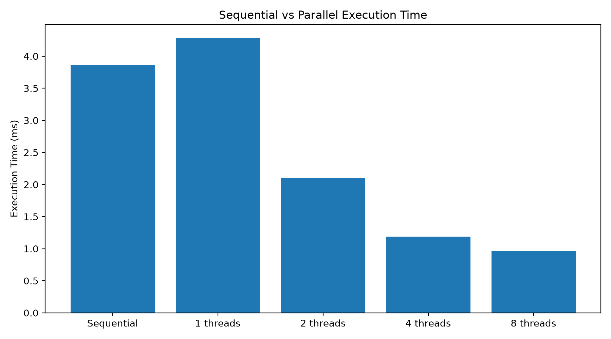
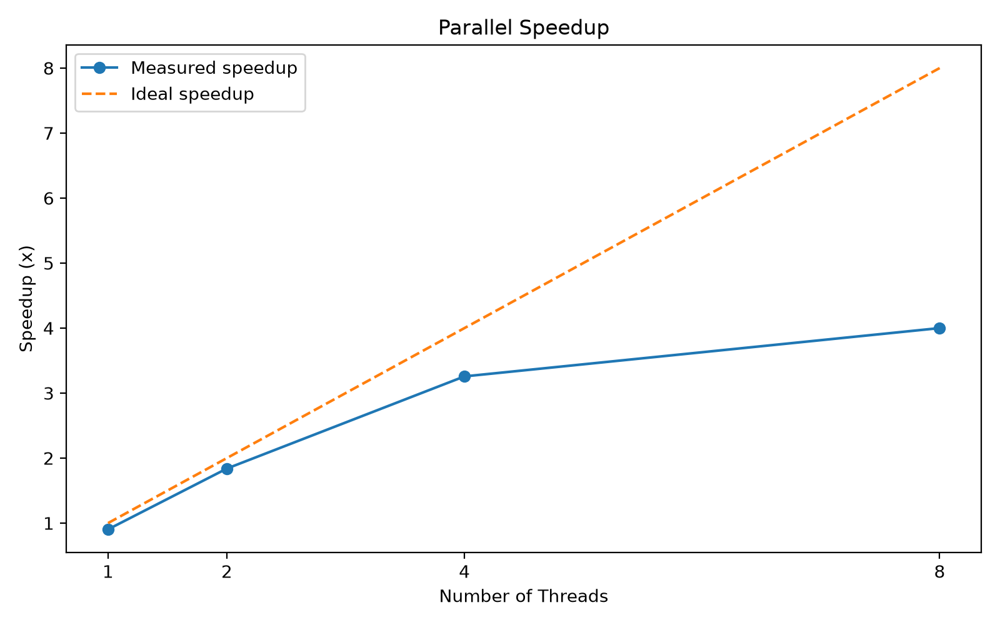
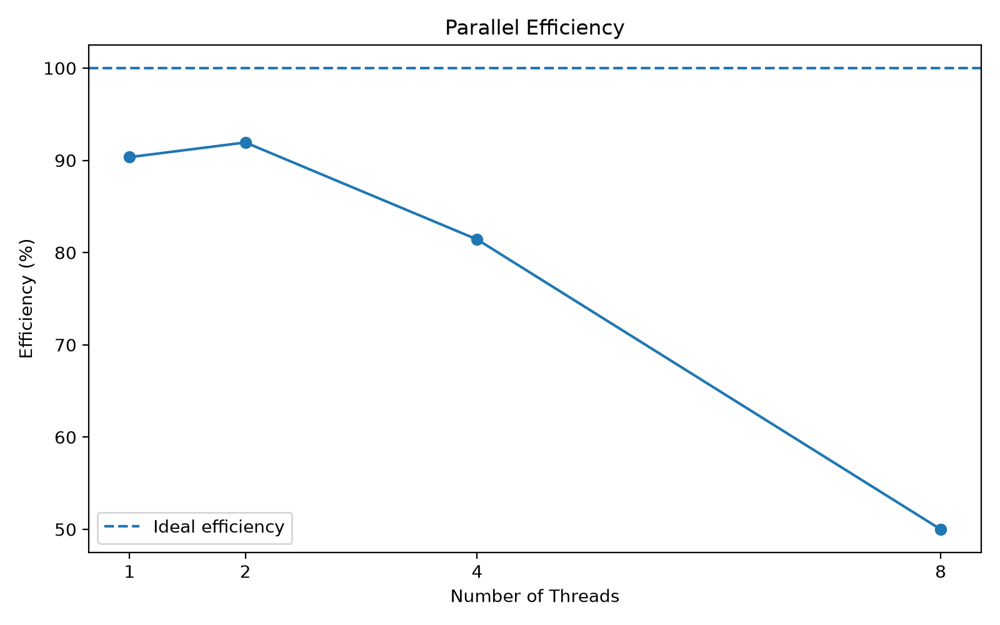

# CPU Performance Benchmark & Parallel Processing Toolkit

A C++17 benchmarking tool that compares sequential and multithreaded execution to study how thread count affects execution time, speedup, and parallel efficiency.

The project uses `std::thread` for parallel computation, validates results using checksums, and exports benchmark measurements to CSV for analysis and visualization.

## Features

- **Sequential vs. Parallel Execution:** Compare single-threaded computation with multithreaded execution.
- **Configurable Parallelism:** Benchmark execution with 1, 2, 4, and 8 threads.
- **Workload Partitioning:** Divide iterations into chunks and distribute work across worker threads.
- **Correctness Validation:** Compare checksums to verify sequential and parallel results.
- **Repeated Benchmarking:** Perform warm-up runs and collect seven timed trials per configuration.
- **Performance Metrics:** Calculate average and median execution time, speedup, and parallel efficiency.
- **CSV Export:** Export summary results and individual trial measurements.
- **Performance Visualization:** Generate charts for execution time, speedup, and parallel efficiency.
- **Object-Oriented Design:** Separate benchmarking, parallel processing, result storage, and CSV export into dedicated classes.

## Tech Stack

- C++17
- Standard Template Library (STL)
- `std::thread`
- `std::chrono`
- CMake
- Python 3 and Matplotlib for visualization
- CSV file handling

## Project Structure

```text
cpu-performance-toolkit/
├── include/
│   ├── BenchmarkResult.hpp
│   ├── BenchmarkRunner.hpp
│   ├── ParallelEngine.hpp
│   └── CSVExporter.hpp
├── src/
│   ├── BenchmarkRunner.cpp
│   ├── ParallelEngine.cpp
│   └── CSVExporter.cpp
├── results/
│   ├── benchmark.csv
│   ├── trial_results.csv
│   └── plots/
│       ├── execution_time.png
│       ├── speedup.png
│       └── efficiency.png
├── main.cpp
├── plot_results.py
├── CMakeLists.txt
├── .gitignore
└── README.md
```

## Requirements

- A C++17-compatible compiler
- CMake
- Python 3
- Matplotlib
- A system with support for C++ threads

## Build and Run

### 1. Clone the repository

```bash
git clone https://github.com/mohdfarahidali987-sketch/CPU-performance-toolkit.git
cd CPU-performance-toolkit
```

### 2. Configure the project

```bash
cmake -S . -B build-release -DCMAKE_BUILD_TYPE=Release
```

### 3. Build

```bash
cmake --build build-release
```

### 4. Run the benchmark

```bash
./build-release/cpu_benchmark
```

Enter an iteration count between `1000` and `100000000` when prompted.

The program benchmarks sequential execution and parallel execution using 1, 2, 4, and 8 threads.

## Benchmark Methodology

The current implementation:

1. Executes warm-up runs before timed measurements.
2. Uses the sequential result as the reference checksum.
3. Runs seven timed trials for sequential execution and each parallel thread configuration.
4. Alternates the order of sequential and parallel measurements to help reduce systematic timing bias.
5. Calculates average and median execution times.
6. Calculates speedup and parallel efficiency using median timings.
7. Validates the checksum of each measured result.
8. Exports summary results and raw trial measurements to CSV files.

## Performance Metrics

### Speedup

Speedup compares sequential median execution time with parallel median execution time.

`Speedup = Sequential Median / Parallel Median`

A speedup greater than `1` indicates that the parallel configuration was faster in the measured run.

### Parallel Efficiency

`Efficiency (%) = (Speedup / Number of Threads) × 100`

Efficiency measures speedup relative to the number of threads. It can vary with workload size, thread-management overhead, CPU architecture, compiler optimizations, and system load.

## Sample Benchmark Results

The following example is from a local run with 10,000,000 iterations. Results are specific to that run and may vary across systems.

| Threads | Median Time (ms) | Speedup | Efficiency |
|---:|---:|---:|---:|
| 1 | 3.984 | 0.937× | 93.7% |
| 2 | 1.997 | 1.870× | 93.5% |
| 4 | 1.184 | 3.155× | 78.9% |
| 8 | 0.950 | 3.931× | 49.1% |

All four configurations passed checksum validation in this example.

## Performance Visualization

The Python plotting script generates three charts using median timings from `results/benchmark.csv`.

### Execution Time Comparison



### Parallel Speedup



### Parallel Efficiency



### Generate the charts

Install Matplotlib if necessary:

```bash
python3 -m pip install matplotlib
```

Run the plotting script from the project root:

```bash
python3 plot_results.py
```

The generated charts are saved in `results/plots/`.

## CSV Results

### Summary Results

`results/benchmark.csv`

Contains the execution mode, iteration count, thread count, recorded time in milliseconds, and checksum. It includes average and median timing summaries.

### Raw Trial Measurements

`results/trial_results.csv`

Contains individual trial measurements for sequential and parallel configurations, allowing more detailed analysis of timing variation.

Both CSV files can be opened using Excel, Google Sheets, or other data-analysis tools.

## Limitations

- Results depend on the processor, operating system, compiler, build settings, and background system activity.
- Thread creation and scheduling introduce overhead, especially for small workloads.
- Sequential and parallel implementations may be optimized differently by the compiler.
- Repeated trials improve measurement quality but do not eliminate all sources of variability.

Therefore, benchmark results should be interpreted as measurements of this implementation, not universal hardware performance guarantees.

## Future Improvements

- Add automated benchmarks across multiple iteration counts.
- Compare different workload sizes and scheduling strategies.
- Improve benchmark fairness by investigating compiler optimization and measurement effects.

## Learning Outcomes

This project explores:

- C++ object-oriented programming
- Multithreading and thread synchronization
- Workload partitioning
- Execution-time measurement with `std::chrono`
- Checksum-based correctness testing
- Performance analysis and CSV data export
- Benchmark visualization using Python and Matplotlib

## Author

**Muhammad Farahid Ali**

GitHub: [mohdfarahidali987-sketch](https://github.com/mohdfarahidali987-sketch)

---

*Built as a C++ systems-programming project to explore multithreading and performance benchmarking.*